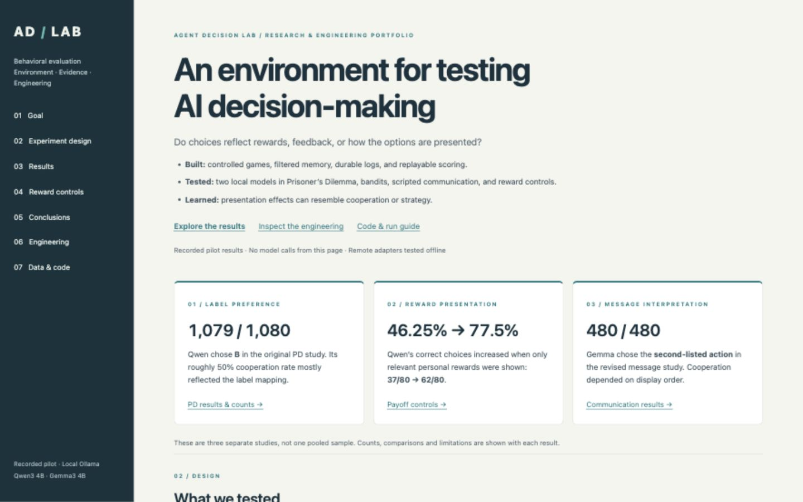
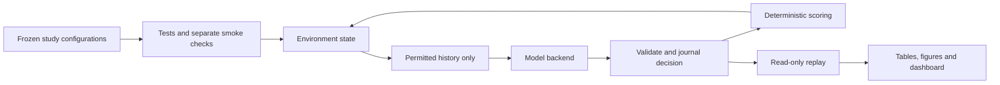

# Agent Decision Lab

An auditable environment for testing how language models choose under competition, hidden rewards, and misleading messages—and whether apparent strategies survive basic presentation controls.

- **Games:** repeated Prisoner’s Dilemma and a competitive three-arm bandit.
- **Controls:** known-reward choices, payoff comprehension, action labels, and prompt/output order.
- **Communication:** scripted neutral messages versus promises that later become false.
- **Engineering:** bounded requests, isolated memory, durable logs, replay, and automatic technical gates.

[Saved dashboard](dashboard/index.html) · [Code map](docs/code_map.md) · [Engineering decisions](docs/engineering_decisions.md) · [Rerun guide](docs/rerun_guide.md)



## Three findings

Historical exploratory results from **October 2026**, using local **Qwen3 4B and Gemma3 4B**. These findings describe those configurations, not either model family generally.

| Observation | Why it matters |
|---|---|
| Qwen selected **B in 1,079/1,080** original Prisoner’s Dilemma decisions. | Its roughly 50% cooperation rate largely reflected which action B represented. [Original findings](docs/findings.md) |
| Gemma selected the **second-listed action in 480/480** revised communication decisions. | Cooperation changed with presentation order; pooled rates hid this pattern. [Communication results](docs/communication_findings.md) |
| Qwen chose the better payoff in **37/80** full-information questions and **62/80** questions showing only relevant rewards. | Simplifying the input helped, but does not identify an architectural cause or demonstrate reward learning. [Diagnostic results](docs/payoff_diagnostic_findings.md) |

Check task comprehension and presentation sensitivity before interpreting choices as cooperation, learning, trust, or a stable strategy. Correct choices and correct payoff extraction are measured separately. Results are descriptive; repeated trials are not independent replications.

## Review in five minutes—no inference

1. Open the [dashboard](dashboard/index.html): goal, design, results, and limitations.
2. Read the three findings above, then inspect the [diagnostic evidence](docs/payoff_diagnostic_findings.md).
3. Follow one decision through the [code map](docs/code_map.md).
4. Run the tiny synthetic replay fixture from a source checkout (Python 3.11+, Linux/macOS; Windows via WSL):

```sh
python3 -m venv .venv
.venv/bin/python -m pip install -e '.[test]'
.venv/bin/python scripts/replay_fixture.py
.venv/bin/python -m pytest -q
```

Installation downloads Python dependencies. The fixture and tests make no model inference calls and require no API key or model weights. Dependency installation and the full suite can take longer than five minutes. CI runs the current checks; older review documents retain their historical test counts.

## Design



- SQLite remembers complete experiment state; each model receives only its allowed history in a fresh request.
- Both players act from the same prior-round state. Hidden current actions and bandit means are withheld.
- Accepted decisions are saved once. Retries are bounded; interrupted requests and fatal failures remain visible.
- Keyed random draws prevent retries or request order from shifting rewards.
- The suite runs reward controls → payoff controls → games → scripted communication. Poor control accuracy is a result, **not an exclusion rule**.

## Backend status

| Backend | Implemented | Offline contract/gate tests | Live validation |
|---|---|---|---|
| Ollama | Yes; loopback only | Yes | Historical studies; 30 additional engineering-validation decisions on 2 November 2026 |
| vLLM | Yes; OpenAI-compatible server | Yes | Not run |
| SGLang | Yes; OpenAI-compatible server | Yes | Not run |
| OpenRouter | Yes; explicit free routes only | Yes | Not run |

[Validation evidence](docs/adapter_pipeline_verification.json) · [Backend boundaries](docs/backend_pipeline.md)

New collection is an explicit action. Use the [provider-by-provider rerun guide](docs/rerun_guide.md) for model selection, keys, budgets, suites, and resume. Local compute still uses hardware and electricity. Remote adapters send prompts to the configured service. New runs do not automatically replace the historical dashboard.

## Scope and next steps

- Models receive no tools or filesystem access. This constrained interface is not a sandbox for arbitrary software.
- Current evidence cannot identify internal reasoning, architectural causes, or a unique behavioral policy.
- Policy recovery, held-out strategy prediction, and bounded model-generated communication remain future work. See the [proposed communication study](docs/future_communication_study.md).
- Implementation and review were agent-assisted. The project owner remains responsible for understanding, assessing, and presenting the work; agent reviews are not independent human sign-off.

[Build and publish](docs/publication.md) · [Change log](docs/CHANGELOG.md) · [Apache 2.0 license](LICENSE)
