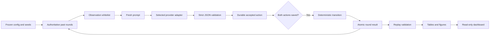

# Code map and review guide

The central distinction is between **complete environment state**, which the evaluator may use to score, and **permitted observations**, which the model may use to decide. Read those boundaries before reading the dashboard code.

For the complete execution sequence, controls, provider setup and later study extensions, see the [rerun guide](rerun_guide.md). `game_lab/suite.py` orchestrates the four study stages; `game_lab/pipeline.py` applies the technical gates to each stage.

For other models and serving backends, see [model onboarding](model_onboarding.md): generator parameters, collection/metadata locations, CLI examples, and what is automatic.

## One decision from start to finish

| Stage | File and function | Input → output | What to verify |
| --- | --- | --- | --- |
| Assign | `make_configs.py::batches` | Study choices → balanced episode bank | All three PD conditions share base blocks, seats, and labels. Bandit covers six permutations under both seats. |
| Validate | `runner.py::validate_config`, `engine.py::validate_episode` | JSON → accepted configuration | Legal conditions, players, budgets, horizons, reward ranges, and bounded retries. |
| Freeze | `runner.py::_initialize` | Config + provider metadata → manifest | Model digests, Python/NumPy versions, source hashes, prompt/script versions, seed mapping. |
| Remember | `store.py::history` | Episode ID → completed round records | Only this episode; sorted trial numbers. Pending current choices are not past history. |
| Filter | `engine.py::observation` | Complete history + player → permitted view | C1 no outcome fields; C2/C3 opponent rewards only; bandit no means or opponent ports. |
| Render | `engine.py::prompt` | Rules + view → exact request text | No previous chat. Bandit tables preserve every value without rounding. |
| Request | `provider.py::Ollama.choose` | Prompt → raw provider response | Loopback-only, no proxies/redirects/tools, context guard, timeout, schema output, capped tokens. |
| Validate and save | `runner.py::_attempt` | Raw response → accepted action or recorded failure | One exact `choice` key. No repair, fallback action, hidden retries, or advance on failure. |
| Score | `engine.py::transition` | Both actions + prior state → rewards/scores | PD payoff cell or keyed independent bandit draw. No request-order dependence. |
| Commit | `store.py::commit_round` | Both durable actions + result → one atomic round | Outcome and episode status update occur together. Decisions were journaled independently beforehand. |
| Replay | `runner.py::replay` | SQLite evidence → verification result | Manifest/config consistency, continuous round sequence, both decisions, raw actions, exact snapshots, scores. |
| Analyze | `analyze.py::summarize`, `contrasts` | Verified read-only traces → CSVs | C1 exclusion, null denominators, strict wins, whole matched blocks, separate targets, claim gates. |
| Present | `dashboard/app.js`, `serve.py` | Saved data → views and progress | Text-safe rendering; no model requests or experiment writes. |

## Walk through a payoff by hand

Assume A means cooperate and B means defect. In round 1 the focal model selects A and its opponent selects B. The engine assigns rewards `[0, 5]` and scores `[0, 5]`.

Before round 2:

- C1 focal memory contains `own_actions: ["A"]`; there is no reward or score field.
- C2/C3 additionally contain `opponent_rewards: [5]`. Given the payoff table, the model can infer that the opponent chose B and that its own reward was 0.
- The complete state remains in SQLite for scoring. Its existence in the evaluator does not authorize placing it in a prompt.

For bandits, if a port mean is 0.7 and its keyed noise draw is −0.1, that selected reward is 0.6. The model sees the sample 0.6, not the mean or noise draw. A different port selection retrieves that port’s separately keyed draw. It does not consume the next number in a mutable shared stream.

## Walk through a retry and restart

1. The runner persists the exact observation and prompt and creates attempt 1 with status `started`.
2. A transient provider failure is recorded; the trial does not advance. The next attempt uses the same snapshot and decoder seed.
3. A valid JSON action and its attempt record are saved in the same transaction.
4. If the runner stops before the opponent returns, the valid action survives. Restart requests only the missing action.
5. If both actions survived but the outcome did not, restart commits the pending outcome without another model call.
6. A crash while a request is in flight is labelled `ambiguous`. The provider may have computed a response that was never saved. Retries remain capped; the environment guarantees one committed decision, not exactly one external computation.

## How memory works

There is no model fine-tuning and no hidden conversational memory. Each request contains only rules plus the entire permitted history for that episode. The engine resets by creating a new episode ID and empty history. Cross-episode information never enters the observation builder. Models cannot query the database.

Stored observations are fresh dictionaries. Bandit history is rendered as a compact table with explicit column names, preserving full floating-point rewards and both score sequences. The conservative context guard uses UTF-8 byte length plus a reserve against the configured context cap; an oversized prompt fails visibly instead of dropping history.

## Read the analyses correctly

| Output | Meaning | What it does not establish |
| --- | --- | --- |
| Cooperation fraction | Cooperative actions / observed eligible rounds | Morality or overall competence |
| Conditional cooperation | Next cooperation after a visible previous outcome | A uniquely identified strategy or motive |
| Bandit win rate | Strict wins / completed independent dyads | Stable superiority from 12 dyads |
| Expected-point regret | `expected_total_regret` sums highest mean minus chosen mean; `mean_regret_per_pull` divides by observed pulls | Error under a chance-of-winning objective |
| Post-switch message contrast | Promise minus neutral response under the same opponent schedule | General trust, emergent deception, or robustness to other scripts |
| Bootstrap interval | Resampling variation across matched episode blocks | Validated small-sample coverage or internal model confidence |
| `analysis_gates.json` | Explicit status of the broader section 10 analyses | Successful recovery, fitting, or probe execution |

## Suggested review order

Read `engine.py`, then `tests/test_integrity_review.py` and `tests/test_correctness_review.py`. Follow one round into `runner.py` and `store.py`; inspect the interrupted-request tests. Finally read `analyze.py` alongside `tests/test_analysis_review.py`, then compare one CSV row with its saved trace. This exposes the scientific assumptions before presentation details.

No experiment runner module is modified while a collection is in progress. Reporting code is outside `game_lab/` so dashboard edits do not change the frozen collection hash.

In `decision_features.csv`, run/episode/block/model identifiers, condition tags, and observation hashes are provenance and grouping keys. They are not model-visible evidence and must not become predictor inputs. A future action predictor must use the permitted observation and disclosed prompt, group related episodes before splitting, and keep `decision_targets.csv` separate until scoring. No predictor is fitted in this pilot.

## Follow-up payoff studies

These are independent single-question diagnostics, not extensions of the repeated-game state machine. Original `game_lab` collection files are unchanged.

| Stage | Code | Input → output |
| --- | --- | --- |
| Freeze question set | `followups.studies.generate_config` | Fully crossed factors and five repeats → 400 question specifications |
| Build visible question and hidden scoring key | `followups.studies.build_case` | Specification → prompt, ordered legal responses, and separately stored correct answer |
| Collect once | `followups.studies.run` | Frozen config → durable SQLite question and attempt records; only prompt/legal responses/settings/seed go to Ollama |
| Check evidence | `followups.studies.replay` | Stored config and raw replies → reconstructed prompts, valid parsed answers, and independently rechecked correctness |
| Summarize | `followups.studies.report` | Read-only database snapshot → CSV, exact-evidence JSON, and dashboard JavaScript data |
| Explain | `dashboard/followups.js` | Saved report → accuracy table, factor breakdown, and exact-question inspector |

Every call starts with one fresh user message. The provider receives neither the evaluator's answer field nor previous questions, replies, or scores. Accuracy is correct answers divided by planned questions. Literal-B preference is calculated only where the labels are A/B. First-shown option and first permitted output value are tracked separately.

## Revised communication study

1. `communication/design.py`: creates the matched neutral/promise episodes, semantic choices, display orders, and seeds.
2. `game_lab/engine.py`: semantic-only branches build cooperate/defect payoffs, permitted memory, and messages. Legacy A/B behavior is unchanged.
3. `game_lab/runner.py` and `store.py`: reuse existing bounded local calls, durable choices, and scoring; new databases live in `communication/runs/`.
4. `communication/report.py`: reads a consistent snapshot, replays scoring, and calculates before/transition/after rates plus paired changes in the message gap.
5. `dashboard/communication.js`: displays saved results. It does not run models.

Round 11 introduces the first defection. Its outcome becomes available for the round-12 decision, so the main post-evidence window starts at 12.

## New payoff diagnostic

| Stage | File | What happens |
|---|---|---|
| Design | `diagnostic/design.py` | Build three matched conditions, order controls, prompts, schemas, seeds, and answer keys. Only prompts and schemas go to models. |
| Collection | `diagnostic/collection.py` | Send fresh loopback requests; log each attempt; validate syntax; save valid answers once. Wrong numeric answers remain valid data. |
| Replay | `diagnostic/collection.py` | Reconstruct the planned requests and recompute scoring from saved replies. No inference. |
| Analysis | `diagnostic/report.py` | Count choice accuracy, extraction accuracy, their agreement, order effects, and matched changes. |
| Figure | `make_diagnostic_figure.py` | Draw the four independent prompt-order × answer-order panels from saved summaries. |
| Dashboard | `dashboard/diagnostic.js` | Render saved results, counts, extraction checks, and limits. |

Memory: one fresh prompt per diagnostic request, with no earlier answer or feedback. SQLite retains the evidence for the evaluator. This study is a payoff-selection diagnostic, not a learning task or a model-internals investigation.
